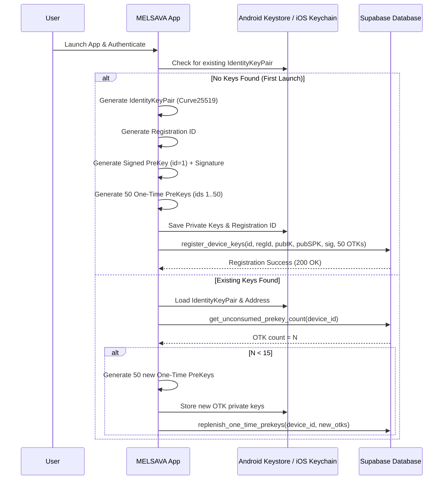

# MELSAVA — Encryption Key Management & Lifecycle Specification

## 1. Key Hierarchy & Cryptographic Roles

| Key Type | Primitive / Spec | Generation Event | Storage / Persistence | Rotation / Lifecycle |
| :--- | :--- | :--- | :--- | :--- |
| **Identity Key Pair ($IK$)** | Curve25519 (Ed25519) | First client initialization | `flutter_secure_storage` (Android Keystore / iOS Keychain) | Permanent per device installation. Replaced only on app data wipe or new device registration. |
| **Registration ID** | 14-bit unsigned integer ($0 \dots 16380$) | First client initialization | `flutter_secure_storage` | Permanent per installation; prevents replay across re-installs. |
| **Signed PreKey Pair ($SPK$)** | Curve25519 + Ed25519 Signature | Client initialization & annual rotation | `flutter_secure_storage` (private) + Supabase `user_devices` (public) | Rotated annually or upon key revocation. Signature verified using user's $IK$. |
| **One-Time PreKey Pairs ($OPK$)** | Curve25519 (Curve point) | Initial batch of 50; replenished when pool $< 15$ | `flutter_secure_storage` (private) + Supabase `user_one_time_prekeys` (public) | Consumed atomically during X3DH session establishment. Deleted from device immediately upon usage. |
| **Ephemeral Key Pair ($EK$)** | Curve25519 | Generated dynamically per session initiation | Transient memory only | Ephemeral; destroyed immediately after deriving root key. |
| **Root Key ($RK$) & Chain Keys ($CK$)** | 256-bit symmetric | Derived via HKDF | `flutter_secure_storage` (SessionRecord) | Advanced continuously by Double Ratchet. |
| **Message Keys ($MK$)** | 256-bit AES + 256-bit HMAC | Derived via KDF ratchet | Ephemeral memory during encryption/decryption | Single-use; destroyed immediately after encrypting/decrypting payload. |

---

## 2. Onboarding & Device Registration Flow



---

## 3. PreKey Pool Replenishment Strategy

1. **Threshold Monitoring**:
   On every app foregrounding and after every decrypted session initiation, the client checks the remaining unconsumed one-time prekeys available on the server:
   ```sql
   SELECT get_unconsumed_prekey_count(device_id := 1);
   ```
2. **Batch Generation**:
   If count $< 15$, the device:
   - Queries its local `SecureSignalProtocolStore` for the highest existing prekey ID $K_{max}$.
   - Generates 50 new prekeys in the range $[K_{max} + 1 \dots K_{max} + 50]$.
   - Persists all 50 private keys into the Android Keystore / iOS Keychain.
   - Uploads public keys to Supabase via `replenish_one_time_prekeys`:
     ```sql
     SELECT replenish_one_time_prekeys(
         p_device_id := 1,
         p_prekeys := '[{"id": 51, "publicKey": "..."}, ...]'::jsonb
     );
     ```
3. **Atomic Consumption (Concurrency Control)**:
   When another user requests a PreKeyBundle, Postgres locks and consumes an available prekey atomically:
   ```sql
   SELECT id, prekey_id, public_key
   INTO v_otk
   FROM public.user_one_time_prekeys
   WHERE user_id = p_user_id AND device_id = p_device_id AND is_consumed = FALSE
   ORDER BY prekey_id ASC
   LIMIT 1
   FOR UPDATE SKIP LOCKED;
   ```
   This eliminates race conditions when multiple users simultaneously message the same recipient.

---

## 4. Key Change Detection & Alerting (Safety Numbers)

1. **Identity Tracking**:
   The `SecureSignalProtocolStore` retains a persistent mapping of `(remote_user_id, device_id) -> IdentityKey`.
2. **Distrusted Key Detection**:
   If Bob re-registers or switches devices, Bob publishes a new Identity Key.
   When Alice's device receives a message from Bob with the new key:
   - The store marks `hasIdentityChanged = true`.
   - The conversation screen displays an alert banner warning Alice that Bob's safety number has changed.
   - Alice is encouraged to verify Bob's 60-digit safety number or QR code in person or via an alternate channel.
3. **Safety Number Calculation**:
   - Uses `NumericFingerprintGenerator(5200)` iterating SHA-512 over sorted user IDs and identity keys.
   - Formatted as 12 groups of 5 digits: `XXXXX XXXXX XXXXX XXXXX XXXXX XXXXX XXXXX XXXXX XXXXX XXXXX XXXXX XXXXX`.
   - Both parties compute the identical 60-digit string regardless of who is sender or recipient.
